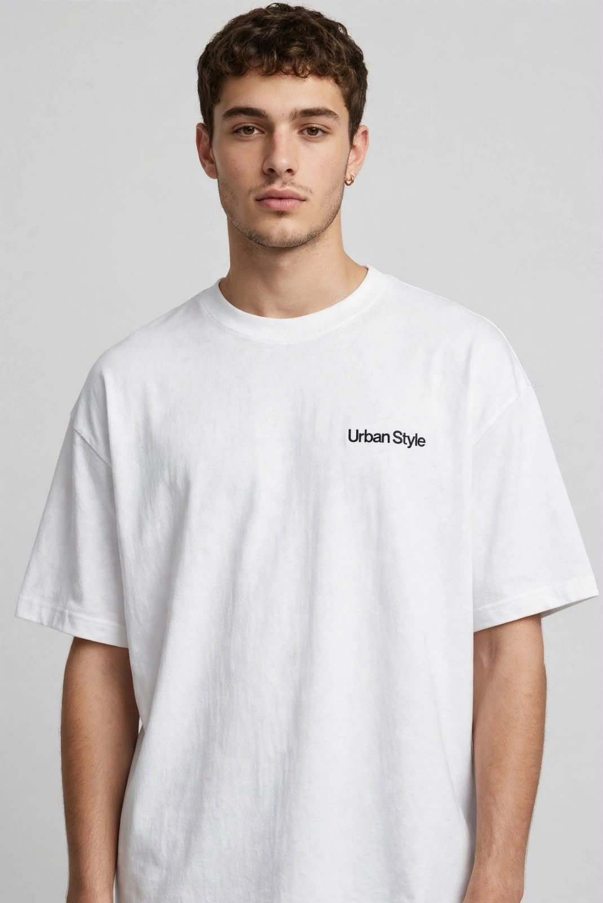

# WEDE5020-PART-3
SEO  

1. Define SEO and explain its purpose in web development.
SEO is the process of improving a website so that it can appear in search engine results. Its purpose is to help people find a website when searching for related products or information. For Urban Style, SEO helps customers find the clothing store online.
2. Explain how SEO practices can improve user experience (UX) and website performance.
SEO improves user experience by making a website easier to navigate and understand. Using clear headings, descriptive links, image alt text and a responsive layout helps visitors use the website on different devices. 
3. Discuss the benefits of implementing SEO on a website.
SEO can help a website get more visitors from search engines and make it easier for customers to find products. It can also improve the website’s visibility, accessibility and user experience. This can help Urban Style reach more potential customers.
4. Explain and demonstrate specific SEO techniques using HTML, CSS and JavaScript where applicable.
Urban Style uses HTML headings, descriptive page titles, image alt text and links to improve SEO. CSS is used to create a responsive layout that works on different screen sizes. JavaScript is used for product searching and filtering, making it easier for customers to find products.
For exmple: <h1>Urban Style</h1> and .

5. Explain the purpose of HTML meta elements and demonstrate relevant examples.
HTML meta elements provide information about a webpage to search engines and browsers. They are placed inside the <head> section of an HTML document. Urban Style uses a title, description and keywords to describe its website.
For example:
<title>Urban Style | Affordable Urban Clothing</title>
<meta name="description" content="Shop affordable urban clothing at Urban Style.">
